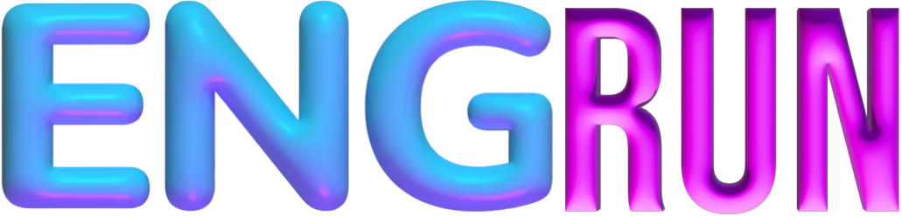

<p align="center"></p>

<p align="center"><b>English</b> · <a href="README.tr.md">Türkçe</a></p>

A gamified study app for Turkey's national English proficiency exams: **YDS**, **e-YDS** and **YÖKDİL**, run by ÖSYM.

**Try it now:** https://osmansakir.github.io/engrun/

- A single HTML file. No framework, no install, no server, no account.
- Your progress is stored in your own browser.
- Works on phones and desktops, with light and dark themes.
- 420 original questions: 4 full YDS-format practice tests (4 × 80) and 100 extra questions by topic.

> The app interface and all explanations are in **Turkish**, because the exams are taken by Turkish speakers. The questions themselves are in English, as on the real exam.

> These are **not** ÖSYM questions. They are written from scratch to mirror the format, difficulty and skills of the real exam.

## Contents
- [Why it exists](#why-it-exists)
- [Features](#features)
- [Learning principles](#learning-principles)
- [How the questions were made](#how-the-questions-were-made)
- [Running it](#running-it)
- [API key and privacy](#api-key-and-privacy)
- [Project layout](#project-layout)
- [Adding questions](#adding-questions)
- [Development history](#development-history)
- [Known limitations](#known-limitations)
- [License](#license)

## Why it exists
Taking practice tests on their own rarely raises a score. If you move on to the next test without understanding why you got something wrong, you keep making the same mistakes.
ENGRUN was built to break that loop:
- It explains every mistake right away.
- It brings mistakes back before you forget them.
- It steers your study time toward the sections that will raise your score fastest.

A simple example: Ayşe is unlikely to double her reading speed in two weeks. But she can learn in one day that "although" is followed by a clause and "despite" by a noun, and win 3-4 questions on the exam.
That is why the app puts quick-win sections first.

## Features

### Goal and roadmap
- **Choose your exam:** On first launch you pick YDS, e-YDS or YÖKDİL. For YÖKDİL you also pick your field: Science, Health or Social Sciences.
- **Date and time:** You pick your exam date from ÖSYM's 2026-2027 calendar or enter your own. You set how long you can study each day (30-120 minutes).
- **Target score:** You decide what score you want; there is no preset target. Type any number (30-100) or tap 50, 60, 70, 80 or 90. The app shows how many correct answers that takes. For example, 65 points needs 52 correct answers out of 80.
  - The target is turned into a target accuracy for each section. Slow-improving sections such as reading are set 10 points lower and the others 5 points higher. For a target of 70, that means 60% in reading and 75% in vocabulary.
  - The plan ranks sections by how far you are from those targets. Someone aiming for 55 won't be pushed to perfect their reading; they'll focus on quick-win sections. Someone aiming for 90 will be pushed in every section.
  - The target lines on the stats screen, the "how many more correct answers" line after a practice test, and the placement test's advice all use this target too.
- **Plan:** The app builds a daily plan based on the days left and recalculates it every day from your results.
  - *More than 5 weeks out:* 5 days a week on weak sections, 1 half test and 1 light day.
  - *Last 5 weeks:* A half test every 4 days.
  - *Last 2 weeks:* Full tests 14, 10, 7 and 4 days before the exam. The last 3 days are red deck only, with light review the day before.
- **Choosing sections:** Each day, the sections that are furthest behind your target, carry the most questions on the exam, and haven't been studied for the longest come first. A fast-improving section is paired with a slow-improving one on the same day.
- **Your daily time is split like this:**
  - 17% review
  - 62% main study
  - 13% vocabulary cards
  - 8% a final look at the day's mistakes
- **Home screen:**
  - countdown
  - target score gauge and how many more correct answers you need
  - today's task list
  - the plan for the next 7 days

### Exam formats
Each exam has its own section breakdown. The predicted score, practice tests, placement test and stats screen are all calculated for the exam you choose.

| Section | YDS / e-YDS | YÖKDİL |
|---|---|---|
| Vocabulary | 6 | 10* |
| Grammar | 10 | 10* |
| Cloze test | 10 | 10 |
| Sentence completion | 10 | 11 |
| Translation EN→TR / TR→EN | 3 + 3 | 6 + 6 |
| Reading | 20 | 15 |
| Dialogue completion | 5 | none |
| Restatement | 4 | none |
| Paragraph completion | 4 | 6 |
| Irrelevant sentence | 5 | 6 |

\* YÖKDİL's first 20 questions mix vocabulary and grammar. ÖSYM doesn't publish a split, so they are counted half and half.

Passages are tagged as science, health or social sciences. If you choose YÖKDİL with a field, passages from your field come first.

### Placement test
- 28 questions in 65 minutes. Every section gets at least one question, in proportions close to the real exam.
- At the end you see your predicted score and the sections costing you the most points. Your roadmap is shaped by this.

### Run mode
A game that moves through the exam's sections in order. Each section is a "gate"; reach the gate's target score to unlock the next one.
- **Score = chips × multiplier:**
  - Each section's chips depend on its weight: vocabulary 10, reading 25, and so on.
  - Every correct answer in a row adds +0.25 to the multiplier (up to ×3).
  - Answering under par time and getting it right after choosing "I'm sure" earn bonuses.
- **Hearts:** A run starts with 5 hearts and each wrong answer costs one. Clear a gate with 80% or more and you get a heart back.
- **Elimination card:** Rule out two options before answering. This practices the elimination skill you need on the exam.
- **Jokers:** Unlock as you master a section, so the reward is tied to working on your weak spots.
  - *Connector Eye:* 20 connector questions right → ×2 chips on connector questions
  - *Tense Master:* 20 grammar questions right → ×2 chips on grammar questions
  - *Translator:* 12 translation questions right → ×2 chips on translation questions
  - *Speed Reader:* 10 reading questions right under par → +30 s par on reading and paragraph questions
- **Par times:** On the real exam you have about 2 min 15 s per question. Each section has its own target time; for example 35 s for vocabulary and 2.5 min for reading.

### Explained feedback
After every question you see:
- The correct option and why it is correct, with an everyday example of the rule (Ayşe, John…).
- Why each wrong option fails, in one sentence.
- The clue words in the question, highlighted.
- The Turkish translation of the sentence or question, key vocabulary, and a short summary of the passage.

### Confidence bet and the red deck
- Before answering you choose "I'm sure", "Not sure" or "Guess".
- Questions you got wrong after saying "I'm sure" go into the **red deck** and come back more often. Research shows people learn best from exactly these surprising mistakes.
- Questions you got right with "Guess" also go into review, because they were right by luck.

### Spaced repetition
- A question you get wrong comes back in the same session, about 10 questions later.
- Then it is asked again after 1, 3 and 6 days. A question that passes all these steps counts as learned.
- The review deck mixes sections, so you have to ask "what type is this?" for each question, just like on the real exam.

### Word marking, dictionary and vocabulary cards
- Tap any word you don't know in a question. Its meaning comes from the built-in dictionary (5,703 words) and the word is added to your vocabulary cards.
- The dictionary recognizes inflected forms: studies → study, avoided → avoid.
- Vocabulary cards test each word inside the sentence where you found it, as multiple choice.

### Practice
Pick a section or a tag and drill targeted questions. Every question is tagged, for example "Tense agreement", "Connector: contrast", "Reading: inference".

### Practice tests
- **Full test:** 80 questions, 180 minutes. You work through one practice set in booklet order.
- **Half test:** 40 questions, 90 minutes, drawn proportionally from all sections.
- Silent, timed and without explanations, like the real exam.
- Jump between questions with the question map, and cross out options to eliminate them.
- Close the page and you can pick up where you left off.
- At the end your score is calculated out of 100 and you review each mistake with its explanation.

### Stats
- Your predicted score and how it has changed over time, with your target line
- Accuracy per section and average time per question compared with par
- Your weakest tags
- Questions you got wrong after saying "I'm sure"
- Your daily streak and unlocked jokers

### Strategy cards
The first time you enter a section, a card with 3-4 tactics appears. Examples:
- **Paragraph completion:** "The sentence after the gap gives the answer away, not the one before it. Read that first."
- **TR→EN translation:** "Find the main verb at the very end of the Turkish sentence."

### Music and sound
- **Generated in code:** Music and sound effects are generated in the browser. There are no audio files, so there is no copyright risk.
- Each section has its own musical mood.
- **Quieter while you read:** Music fades out automatically on reading, paragraph and translation questions, because music while reading lowers comprehension. Practice tests are completely silent.
- **Effects:**
  - a correct-answer sound that rises in pitch as your combo grows
  - a heart-break sound
  - a gate-clear fanfare
  - a score count-up sound
- **Settings:** Sound and vibration can be turned off in settings. If "reduce motion" is on in your operating system, animations stop.

### Optional Claude features
If you enter your own Anthropic API key, two buttons appear:
- **Explain it differently:** Re-explains the question another way, with a new example.
- **Generate a similar question:** Writes a new question that tests the same skill. A second call that can't see the answer solves it again, and if the two answers don't match, the question isn't shown.

Without a key, the rest of the app works exactly the same.

## Learning principles
Every mechanic in the app is based on a known finding about learning:

| Principle | In the app |
|---|---|
| Testing effect (Roediger & Karpicke, 2006) | The core activity is answering questions, not rereading |
| Immediate, explained feedback (Butler & Roediger, 2008) | After every answer: the correct option, why the others are wrong, and clues |
| Hypercorrection (Metcalfe, 2017) | Confident mistakes go into the red deck |
| Spaced repetition (Leitner system) | Same session → 1 → 3 → 6 days |
| Interleaved practice (Rohrer & Taylor, 2007) | The review deck mixes sections |
| Deliberate practice | Weak spots by tag and targeted drills |
| Music while reading hurts focus | Music fades on reading sections; practice tests are silent |

## How the questions were made
Each question was written from scratch to test the same skill, at the same difficulty, as a real YDS question.
- **Same skill, different content:**
  - Section, tags, difficulty and trap type were kept. If the source question tests tense agreement, the new one does too.
  - Topic, sentences, options, names and numbers are all new. If the source passage is about diabetes, the new one might be about coffee and sleep.
- **Copy check:**
  - Every question and passage was compared with its source in 6-word chunks, and any shared wording was rewritten.
  - The only overlap left is standard question stems such as "According to the passage…".
- **Blind solving:**
  - Each of the 320 practice-test questions was solved from scratch by a separate solver that never saw the answer key. Every one matched.
  - This catches broken questions and questions with two defensible answers.
- **Balanced answer letters:** Answers in each set are spread roughly evenly across A-E, so there's no "it's always C in this set" pattern.
- **Explanations:** Written in Turkish. Each rule is explained with an everyday example, and every wrong option gets a one-sentence reason.

Format and rules are documented in [`tools/SCHEMA.md`](tools/SCHEMA.md) (in Turkish).

## Running it
```sh
git clone https://github.com/OSMANSAKIR/engrun.git
cd engrun
python3 -m http.server 8000
# open http://localhost:8000
```
Opening the file directly (`file://`) won't work, because the questions are loaded with `fetch`. Any static host works: GitHub Pages, Netlify, or your own site.

To add it to another site, `tools/export_site.sh <target-folder>` copies only the files that need to be published.

## API key and privacy
- The app contains no API key. Anyone who wants the Claude features enters their own.
- Your key stays only in your browser:
  - By default it is deleted when you close the tab.
  - If you choose "Remember on this device", it is kept in `localStorage`.
  - It is never written to your progress data and is only ever sent to `api.anthropic.com`.
- The page's Content-Security-Policy allows outgoing connections only to `api.anthropic.com`. No external scripts, fonts or trackers are loaded; the fonts live in the repo.
- We recommend creating a separate key for this and setting a spending limit in the [Anthropic Console](https://console.anthropic.com).
- Your progress (answers, review boxes, words, goal) is kept only in your browser's local storage and is never sent to any server.

## Project layout
| Path | Contents |
|---|---|
| `index.html` | The whole app: styles, game, sound, storage |
| `data/manifest.json` | List of question files to load |
| `data/generated/set-01…04.json` | Full practice tests (80 questions each) |
| `data/generated/gen-*.json` | Extra questions by topic (vocabulary, grammar, sentence, paragraph; 25 each) |
| `data/dict.json` | English-Turkish dictionary (every word in the questions) |
| `assets/engrun-logo.svg` | Logo |
| `fonts/` | Bungee, JetBrains Mono, Nunito (SIL OFL 1.1) |
| `tools/SCHEMA.md` | Question JSON format, section and tag lists, rules for original questions |
| `tools/validate.py` | Checks question files: format, counts, answer-letter balance, duplicate IDs |
| `tools/wordlist.py` | Finds words missing from the dictionary |
| `tools/build_dict.py` | Adds new meanings to the dictionary |
| `tools/export_site.sh` | Copies the publishable files to another folder |
| `tools/build_artifact.py` | Builds the claude.ai Artifact version |

## Adding questions
1. Write a JSON file in the format described in [`tools/SCHEMA.md`](tools/SCHEMA.md) and put it in `data/generated/`.
2. Add it to `data/manifest.json`:
   - under `booklets` if it is a full practice test
   - under `generated` if it is a set of extra questions
3. Check it with `python3 tools/validate.py`.
4. Update the dictionary:
   - `python3 tools/wordlist.py --missing 1000` writes words missing from the dictionary to `work/dict/todo-XX.txt`.
   - Write their meanings to `work/dict/out-XX.jsonl`, one per line: `{"f": "studies", "l": "study", "tr": "çalışma; incelemek"}`.
   - `python3 tools/build_dict.py` merges them into `data/dict.json`.

Found a wrong answer, a question with two correct options, or a factual error? Please open an issue.

## Development history
The project started 10 days before the November 2026 YDS as a personal study tool called "YDS Koşusu" ("YDS Run"). It then grew into a product anyone can use and was renamed ENGRUN.

1. **First version:**
   - Run mode, chips × multiplier scoring, hearts and jokers.
   - Spaced repetition, the red deck, practice tests and the stats screen.
   - Music and sound effects generated in code, and a phone-friendly interface.
2. **Explanations and vocabulary:**
   - Turkish explanations, clues, translations and tags for every question.
   - Word marking, vocabulary cards and the built-in dictionary.
3. **Claude features:**
   - "Explain it differently" and "Generate a similar question".
   - Generated questions are checked by blind solving.
   - The key is kept only in the user's browser.
4. **Placement test and strategy:**
   - A 28-question placement test and predicted score.
   - Strategy cards and common traps for each section.
5. **Goal and roadmap:**
   - Exam choice (YDS, e-YDS, YÖKDİL) and ÖSYM's 2026-2027 calendar.
   - The plan follows the user's own target score and daily time; no target is imposed.
   - Scoring follows the chosen exam's format.
6. **Preparing the public release:**
   - Personal data and ÖSYM questions were removed from the repo.
   - Fonts were self-hosted and a Content-Security-Policy was added.
7. **Original practice tests:**
   - 4 × 80 original questions testing the same skills replaced the ÖSYM questions. All passed the copy check and blind solving.
   - Passages were tagged by YÖKDİL field.
   - The dictionary grew to 5,703 words.

## Known limitations
- **Blind solving is not a substitute for human review.** It was done by an automated solver. It catches broken or double-answer questions, but not cases where the writer and the solver make the same mistake. A final human review is still valuable.
- **The extra questions were checked less strictly.** The 100 extra questions did not go through the same blind solving as the practice tests.
- **Facts in passages were not checked against sources.** Dates and figures rely on general knowledge.
- **The predicted score is not official.** It is an estimate based on your recent accuracy in each section.
- **Progress is tied to the browser.** If you clear your browser data, your progress is deleted too.

## Exam calendar
Dates come from ÖSYM's 2026-2027 calendar (`EXAM_CALENDAR` in `index.html`). The calendar may change;
check [osym.gov.tr](https://www.osym.gov.tr) before you register.

## License
- **Code** (`index.html`, `tools/`): [MIT](LICENSE)
- **Questions and dictionary** (`data/`): [CC BY-NC 4.0](data/LICENSE.md). Free to use for any non-commercial purpose with attribution.
- **Fonts** (`fonts/`): SIL Open Font License 1.1
- **Logo** (`assets/engrun-logo.svg`): © Osman Şakır, all rights reserved.
